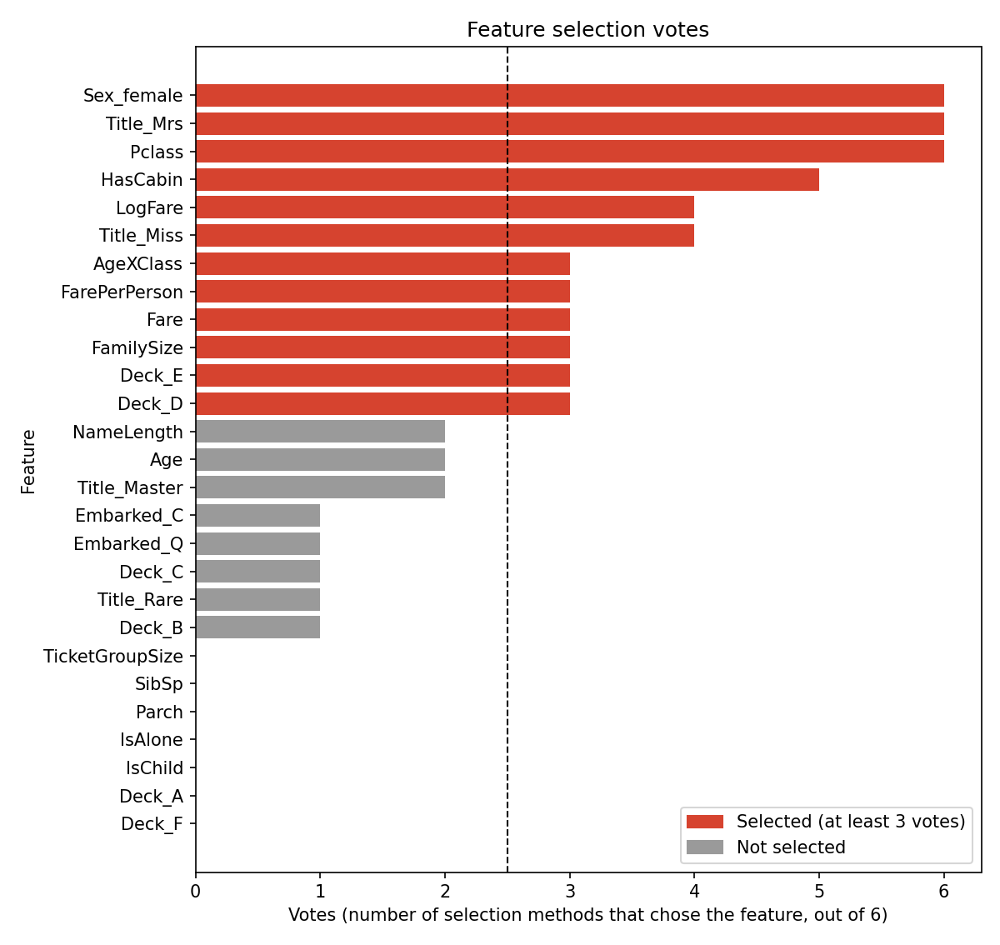
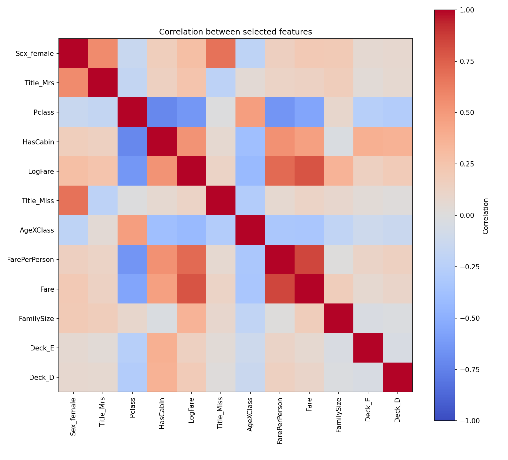
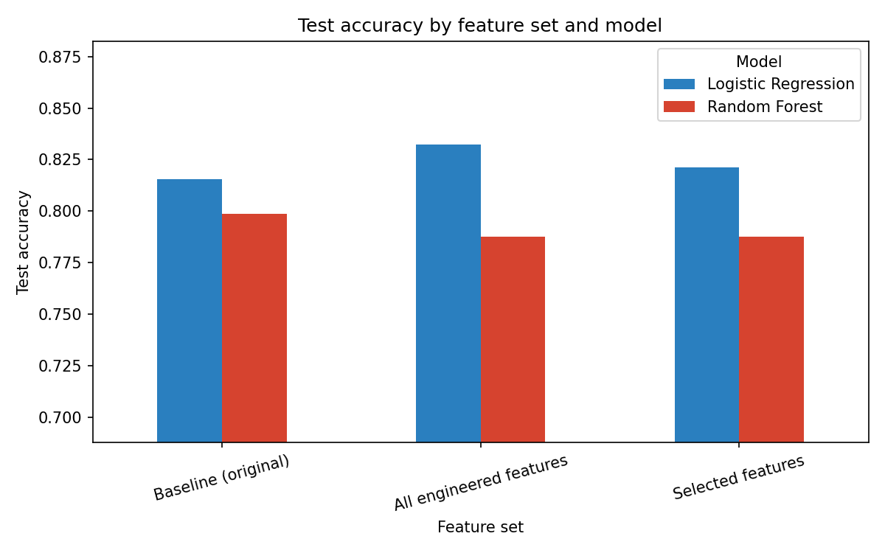

# Feature Engineering and Selection Report

*This report is generated automatically by `src/feature_engineering.py`; every number comes from the run.*

## 1. Goal and dataset
Prepare the Titanic passenger data for machine learning, then find a smaller set of features that predicts survival (`Survived`: 1 = survived) as well as the full set. The data has 891 passengers and the original columns PassengerId, Survived, Pclass, Name, Sex, Age, SibSp, Parch, Ticket, Fare, Cabin and Embarked (Kaggle *Titanic: Machine Learning from Disaster*, `train.csv`).

## 2. Process overview
1. **Cleaning:** missing Embarked filled with the most common port, missing Age with the median age of the passenger's class and sex, missing Fare with the class median.
2. **Feature creation and encoding:** 29 candidate features were built (table below).
3. **Train/test split:** 80/20 stratified split (712 train / 179 test), `random_state=42`. All selection steps use the training set only, to avoid data leakage.
4. **Scaling:** `StandardScaler` (mean 0, standard deviation 1) applied to the continuous features, fitted on the training set and then applied to the test set. Binary and one-hot columns are left as 0/1.
5. **Filtering:** low-variance and highly correlated features removed.
6. **Selection:** six methods each choose their top 10 features; features chosen by at least 3 methods are kept.
7. **Evaluation:** the selected set is compared with a baseline and with all engineered features.

## 3. Features created and encoded
| Feature | Built from | Description |
|---|---|---|
| `Title_*` | Name | Title (Mr, Mrs, Miss, Master, Rare) extracted from the name; captures sex, age and social status together. One-hot encoded with Mr as the baseline. |
| `FamilySize` | SibSp, Parch | SibSp + Parch + 1: people travelling together. |
| `IsAlone` | FamilySize | 1 if the passenger travelled alone. |
| `HasCabin` | Cabin | 1 if a cabin number was recorded (Cabin is mostly missing, so the flag is more useful than the value). |
| `Deck_*` | Cabin | Deck letter from the cabin number, one-hot encoded with 'unknown' as the baseline. |
| `TicketGroupSize` | Ticket | Number of passengers sharing the same ticket. |
| `FarePerPerson` | Fare, TicketGroupSize | Fare divided by ticket group size, because a ticket fare can cover a whole group. |
| `LogFare` | Fare | log(1 + Fare) to reduce the strong right skew. |
| `IsChild` | Age | 1 if age is under 13. |
| `AgeXClass` | Age, Pclass | Interaction: Age multiplied by Pclass. |
| `NameLength` | Name | Number of characters in the name. |
| `Sex_female` | Sex | Binary encoding of Sex (1 = female). |
| `Embarked_*` | Embarked | One-hot encoded port of embarkation with Southampton (S) as the baseline. |

Original columns kept as features: Pclass, Age, SibSp, Parch, Fare.

## 4. Filtering
- **Low variance** (variance below 0.01): dropped `Deck_G`, `Deck_T`. Almost-constant columns carry no information.
- **High correlation** (above 0.9): when two features were this correlated, the one less related to the target was dropped:
  - No pair of features exceeded the threshold.

27 features remained for selection.

## 5. Selection methods
| Method | Type | Idea |
|---|---|---|
| ANOVA F-test | statistical (filter) | Does the feature's mean differ between survivors and non-survivors? |
| Mutual information | statistical (filter) | How much does knowing the feature reduce uncertainty about the target? Captures non-linear links. |
| Chi-squared | statistical (filter) | Dependence between the (0-1 scaled) feature and the target. |
| RFE with logistic regression | wrapper | Repeatedly fits the model and removes the weakest feature. |
| Random forest importance | embedded | How much each feature helps the trees split. |
| Lasso (L1) | embedded | Shrinks the coefficients of useless features towards zero. |

### Votes (1 = chosen by that method)
| Feature | ANOVA_F | MutualInfo | Chi2 | RF_Importance | RFE_LogReg | Lasso | Votes | Selected |
|---|---|---|---|---|---|---|---|---|
| Sex_female | 1 | 1 | 1 | 1 | 1 | 1 | 6 | yes |
| Title_Mrs | 1 | 1 | 1 | 1 | 1 | 1 | 6 | yes |
| Pclass | 1 | 1 | 1 | 1 | 1 | 1 | 6 | yes |
| HasCabin | 1 | 1 | 1 | 0 | 1 | 1 | 5 | yes |
| LogFare | 1 | 1 | 0 | 1 | 0 | 1 | 4 | yes |
| Title_Miss | 1 | 0 | 1 | 1 | 1 | 0 | 4 | yes |
| AgeXClass | 1 | 1 | 0 | 1 | 0 | 0 | 3 | yes |
| FarePerPerson | 1 | 1 | 0 | 1 | 0 | 0 | 3 | yes |
| Fare | 1 | 1 | 0 | 1 | 0 | 0 | 3 | yes |
| FamilySize | 0 | 1 | 0 | 0 | 1 | 1 | 3 | yes |
| Deck_E | 0 | 0 | 1 | 0 | 1 | 1 | 3 | yes |
| Deck_D | 0 | 0 | 1 | 0 | 1 | 1 | 3 | yes |
| NameLength | 1 | 0 | 0 | 1 | 0 | 0 | 2 | no |
| Age | 0 | 1 | 0 | 1 | 0 | 0 | 2 | no |
| Title_Master | 0 | 0 | 0 | 0 | 1 | 1 | 2 | no |
| Embarked_C | 0 | 0 | 1 | 0 | 0 | 0 | 1 | no |
| Embarked_Q | 0 | 0 | 0 | 0 | 0 | 1 | 1 | no |
| Deck_C | 0 | 0 | 1 | 0 | 0 | 0 | 1 | no |
| Title_Rare | 0 | 0 | 0 | 0 | 1 | 0 | 1 | no |
| Deck_B | 0 | 0 | 1 | 0 | 0 | 0 | 1 | no |
| TicketGroupSize | 0 | 0 | 0 | 0 | 0 | 0 | 0 | no |
| SibSp | 0 | 0 | 0 | 0 | 0 | 0 | 0 | no |
| Parch | 0 | 0 | 0 | 0 | 0 | 0 | 0 | no |
| IsAlone | 0 | 0 | 0 | 0 | 0 | 0 | 0 | no |
| IsChild | 0 | 0 | 0 | 0 | 0 | 0 | 0 | no |
| Deck_A | 0 | 0 | 0 | 0 | 0 | 0 | 0 | no |
| Deck_F | 0 | 0 | 0 | 0 | 0 | 0 | 0 | no |



## 6. Selected features
**12 features** were chosen by at least 3 of the 6 methods:

1. `Sex_female` (6 votes)
2. `Title_Mrs` (6 votes)
3. `Pclass` (6 votes)
4. `HasCabin` (5 votes)
5. `LogFare` (4 votes)
6. `Title_Miss` (4 votes)
7. `AgeXClass` (3 votes)
8. `FarePerPerson` (3 votes)
9. `Fare` (3 votes)
10. `FamilySize` (3 votes)
11. `Deck_E` (3 votes)
12. `Deck_D` (3 votes)



## 7. Model performance
Baseline = `Pclass`, `Sex_female`, `Age`, `SibSp`, `Parch`, `Fare`, `Embarked_C`, `Embarked_Q`. Cross-validated (CV) accuracy uses 5 stratified folds on the training set; test metrics use the held-out test set.

| Feature set | Features | Model | CV accuracy | Test accuracy | Test F1 | Test ROC AUC |
|---|---|---|---|---|---|---|
| Baseline (original) | 8 | Logistic Regression | 0.803 +/- 0.027 | 0.816 | 0.744 | 0.845 |
| Baseline (original) | 8 | Random Forest | 0.820 +/- 0.021 | 0.799 | 0.723 | 0.829 |
| All engineered features | 29 | Logistic Regression | 0.819 +/- 0.030 | 0.832 | 0.776 | 0.870 |
| All engineered features | 29 | Random Forest | 0.824 +/- 0.021 | 0.788 | 0.712 | 0.846 |
| Selected features | 12 | Logistic Regression | 0.802 +/- 0.024 | 0.821 | 0.758 | 0.838 |
| Selected features | 12 | Random Forest | 0.816 +/- 0.018 | 0.788 | 0.708 | 0.835 |



- **Logistic Regression:** highest cross-validated accuracy with the *All engineered features* set; the differences between feature sets are smaller than the fold-to-fold variation, so the sets perform about the same.
- **Random Forest:** highest cross-validated accuracy with the *All engineered features* set; the differences between feature sets are smaller than the fold-to-fold variation, so the sets perform about the same.

With 12 features instead of 29, the selected set reaches a test accuracy of 0.788 to 0.821 across the two models, compared with 0.788 to 0.832 for all engineered features.

## 8. Conclusions and limitations
- Feature selection gives a smaller, simpler set of inputs; the table above shows how that compares with using everything.
- The test set is small (179 rows), so differences of a few tenths of a percent are not meaningful.
- Cleaning statistics (medians and modes) and `TicketGroupSize` were computed on the full dataset before splitting. They do not use the target, so the leakage risk is small, but a production pipeline would compute them on the training set only.
- Feature importance shows association with survival, not cause.

## 9. How to reproduce
```bash
pip install -r requirements.txt
python src/feature_engineering.py
```
Outputs: `data/titanic_features.csv`, `docs/feature_scores.csv`, `docs/feature_engineering_report.md`, and charts in `images/`.
